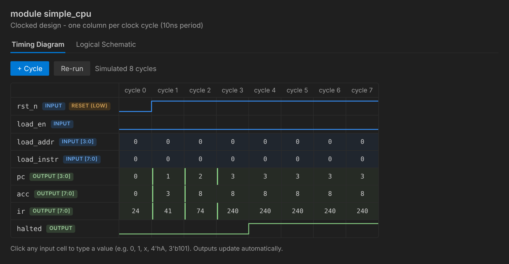
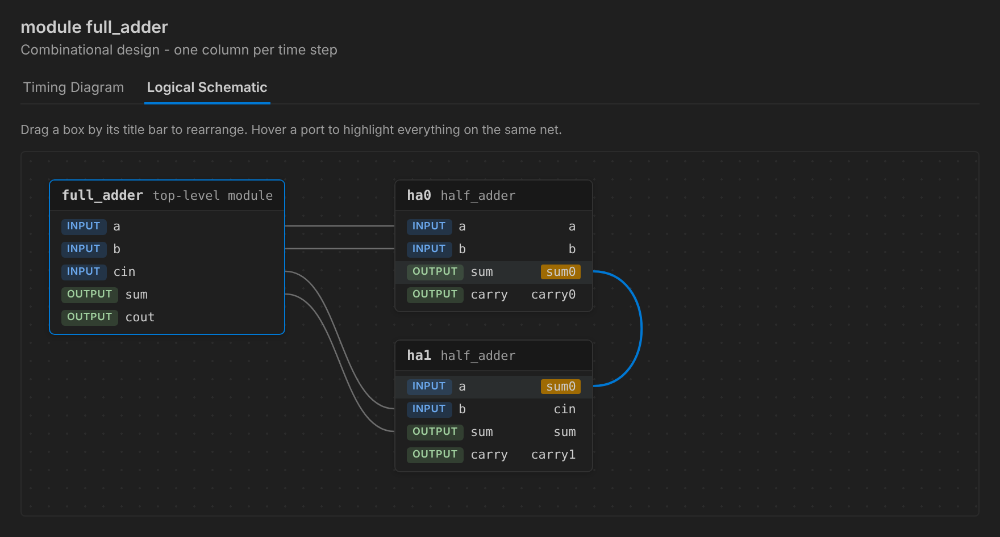
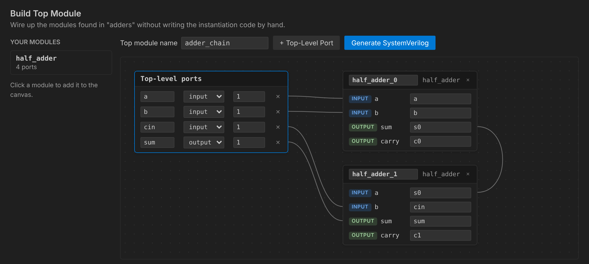

# Veriscode

A VS Code extension for learning SystemVerilog. It lints and formats your
code with [Verible](https://github.com/chipsalliance/verible), and lets you
simulate any module by clicking values into a timing diagram -
[Icarus Verilog](https://github.com/steveicarus/iverilog) runs underneath,
out of sight. No separate tools to install, no command line, no testbench
to write.



## What it does

- **Click-to-simulate.** **▶ Simulate** appears above every module. It
  opens a timing diagram with one column per clock cycle (or per time
  step, for a design with no clock): click an input cell, type a value
  (`0`, `1`, `x`, `4'hA`, `3'b101`...), and the outputs update. Add
  columns as you go. Save the file and the diagram re-runs with the values
  you already entered.
- **A schematic view.** The simulator's second tab draws the module, the
  modules it instantiates and the wires between them. Hover a port to
  highlight its net.
- **Linting and formatting.** Verible checks the file as you type and
  backs **Format Document**.
- **Project templates.** **File → New File... → SystemVerilog Project**
  creates a ready-to-simulate project: a counter, a half or full adder, or
  the **CPU workshop** - six guided stages from a half adder to a working
  8-bit CPU, sized for a 1-2 hour session with no prior HDL experience.
- **A top-module builder.** **Veriscode: Build Top Module (GUI)** wires
  modules you've already written into a new top-level module: pick them
  from a palette, name the nets, and it writes the instantiation code.
- **A sidebar.** The Veriscode icon in the Activity Bar has the actions
  above, plus the active file's module and ports.

| Logical Schematic | Build Top Module |
| --- | --- |
|  |  |

## Install

Veriscode is a single `.vsix` that works in VS Code, VSCodium, Cursor and
other VS Code-based editors: **Extensions view → `...` → Install from
VSIX...**

The release build bundles Verible and Icarus Verilog for Windows (x64),
macOS (Intel and Apple Silicon) and Linux (x64 and arm64) in that one
file, and picks the right binaries at run time. Windows on ARM uses the
x64 binaries through Windows' built-in emulation.

To get it, run the **Build portable multi-platform .vsix** workflow
(manually, or by pushing a `v*` tag) and download its artifact.

## Settings

| Setting | Default | |
| --- | --- | --- |
| `veriscode.verible.lintOnType` | `true` | Lint as you type. |
| `veriscode.verible.lintOnSave` | `true` | Lint on save. |
| `veriscode.verible.formatOnSave` | `false` | Format on save. A file with a syntax error is left untouched. |
| `veriscode.verible.disabledRules` | `["module-filename", "parameter-name-style"]` | Lint rules to turn off. These two would flag the bundled workshop (numbered file names, `ALL_CAPS` constants); set `[]` to enable everything. |
| `veriscode.verible.path` | bundled | A `verible-verilog-lint` to use instead. The formatter is taken from the same folder. |
| `veriscode.simulator.icarusPath`, `vvpPath` | bundled | An `iverilog` / `vvp` to use instead. |
| `veriscode.simulator.defaultCycles` | `8` | Columns shown when a simulation opens. |

## What to expect

Veriscode is a teaching tool, and it trades generality for a simple model:

- **A project is a folder.** Every `.sv`/`.v` file next to the one you
  simulate is compiled with it, so a module can instantiate any module in
  the same folder. There are no include paths or file lists to manage.
- **Simulation is a fresh run every time.** Each edit regenerates a small
  testbench from the whole grid, recompiles and reruns. That takes about
  15 ms for the workshop's CPU, and there is no simulator state to get out
  of sync with what the diagram shows.
- **The module header is read by a small parser, not a full SystemVerilog
  front end.** It understands ANSI-style headers
  (`module m #(...) (input logic [7:0] a, ...);`) and widths built from
  literals and parameter defaults. Icarus Verilog is still what compiles
  your code, so anything it accepts will simulate.
- A port named `clk`/`clock` is treated as the clock, and a reset-like
  name (`rst_n`, `reset`, ...) gets a one-cycle reset pulse by default.
  Both are only starting values; every cell stays editable.

## Development

```bash
npm install
npm run compile
npm test          # needs iverilog on PATH; see below
```

`npm test` runs every `extensions/veriscode/test/*.test.js` against the
compiled extension and a real `iverilog`. The Verible tests use the real
binaries too, if they are bundled or on `PATH`, and are reported as skipped
otherwise - `toolchains/fetch-verible.sh linux-x64` (or your platform)
fetches the pinned release into place.

To try a build in your editor:

```bash
cd extensions/veriscode && npx @vscode/vsce package --no-dependencies -o ../../dist/
```

then install the `.vsix` from `dist/`. A build made this way has no
toolchain inside, so it uses the `iverilog`/`vvp` on your `PATH`
(`apt install iverilog`, `brew install icarus-verilog`, or the
[Windows installer](https://bleyer.org/icarus/)) and, for linting, a
[Verible release](https://github.com/chipsalliance/verible/releases).

### Layout

```
extensions/veriscode/
  src/
    extension.ts          activation: commands, CodeLens, Verible wiring
    verible.ts            running Verible and parsing its output (no vscode import)
    veribleLint.ts        diagnostics and formatting on top of it
    toolchain.ts          finding bundled or PATH binaries
    newProject.ts         New Project command; projectScaffold.ts writes the files
    simulation/           module-header parser, testbench generator, Icarus runner, VCD parser
    generation/           the top-module builder's code generator
    webview/              extension-host side of the three views
  media/                  browser side of the views (plain JS and CSS, no build step)
  templates/              project templates, including the CPU workshop and its guide
  test/                   *.test.js, run by `npm test`
toolchains/               scripts that fetch Verible / Icarus Verilog for bundling
docs/toolchain-notes.md   how the bundling works and what has been verified
```

### CI

- [`ci.yml`](.github/workflows/ci.yml), on every push and pull request:
  compiles, runs the tests against real `iverilog` and Verible on amd64
  and arm64 Linux, and packages a toolchain-free `.vsix`.
- [`build-universal-vsix.yml`](.github/workflows/build-universal-vsix.yml),
  manually or on a `v*` tag: fetches the toolchains for every platform,
  runs the tests on each platform using only those bundled binaries, and
  then packages the release `.vsix`.

## License

MIT - see [LICENSE](LICENSE).
